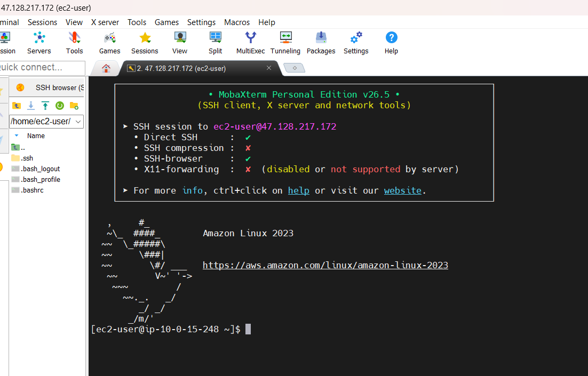

### Week 10 Topic: Amazon Relational Database Service (RDS)

Create the VPC, security groups, and subnet group; launch an RDS database and verify the endpoint.

### Objectives

- Understand the purpose and core concepts of **Amazon Relational Database Service (RDS)**.
- Practice the main steps in the AWS Management Console.
- Record configuration, verification results, and lessons learned.

### Tasks to be carried out this week

| Day | Task | Start Date | Completion Date | Reference Material |
| --- | --- | --- | --- | --- |
| 1 | Read the AWS documentation and identify the knowledge and resources required. | Week 10 - Day 1 | Week 10 - Day 1 | <https://docs.aws.amazon.com/AmazonRDS/latest/UserGuide/Welcome.html> |
| 2 | Practice creating or configuring resources for the weekly topic. | Week 10 - Day 2 | Week 10 - Day 2 | <https://docs.aws.amazon.com/AmazonRDS/latest/UserGuide/Welcome.html> |
| 3 | Verify status, permissions, connectivity, or deployment results. | Week 10 - Day 3 | Week 10 - Day 3 | <https://docs.aws.amazon.com/AmazonRDS/latest/UserGuide/Welcome.html> |
| 4 | Record configuration details and troubleshoot issues. | Week 10 - Day 4 | Week 10 - Day 4 | <https://docs.aws.amazon.com/AmazonRDS/latest/UserGuide/Welcome.html> |
| 5 | Summarize the results and lessons learned. | Week 10 - Day 5 | Week 10 - Day 5 | <https://docs.aws.amazon.com/AmazonRDS/latest/UserGuide/Welcome.html> |

### Achievements

- Understood the role of **Amazon Relational Database Service (RDS)** in AWS.
- Completed the main hands-on steps from the guide.
- Learned how to verify results and record reusable configuration details.

### Image Evidence

Evidence of creating the VPC, security groups, subnet group, RDS database, and endpoint.

### References

- AWS guide: <https://docs.aws.amazon.com/AmazonRDS/latest/UserGuide/Welcome.html>
- Sample worklog: <https://thanhzicne.github.io/aws-learning-journey/vi/1-worklog/>
- GitHub: <https://github.com/HuuPhuoc-NH/fcj-workshop-template>

