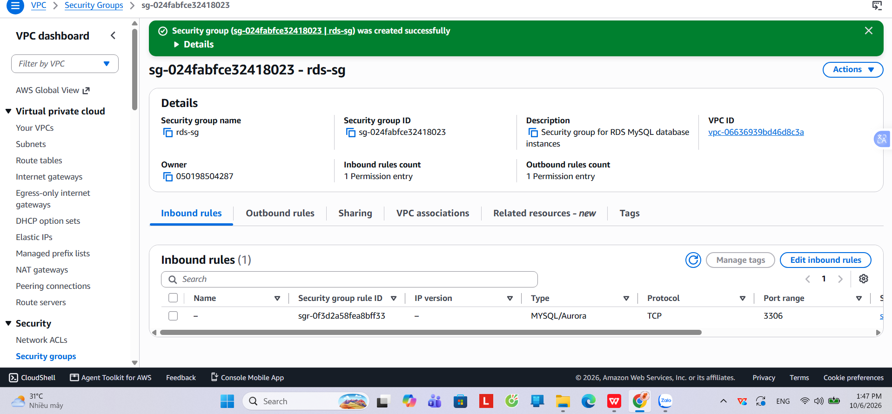
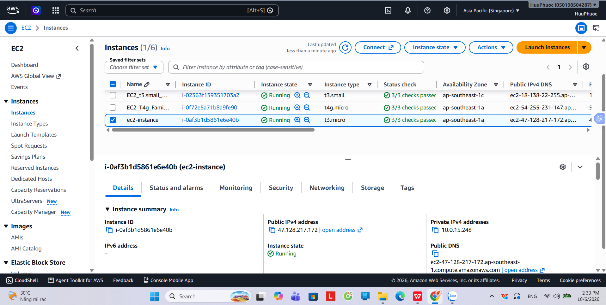

### Week 10 Topic: Amazon Relational Database Service (RDS)

Create the VPC, security groups, and subnet group; launch an RDS database and verify the endpoint.

### Week 10 Objectives:

- Understand the purpose and core concepts of **Amazon Relational Database Service (RDS)**.
- Practice the main steps in the AWS Management Console.
- Record configuration, verification results, and lessons learned.

### Tasks to be carried out this week:

| Day | Task | Start Date | Completion Date | Reference Material |
| --- | --- | --- | --- | --- |
| 2 | Read the AWS guide and prepare the knowledge required for Amazon Relational Database Service (RDS). | 16/11/2026 | 16/11/2026 | <https://docs.aws.amazon.com/AmazonRDS/latest/UserGuide/Welcome.html> |
| 3 | Practice creating or configuring resources for Amazon Relational Database Service (RDS). | 17/11/2026 | 17/11/2026 | <https://docs.aws.amazon.com/AmazonRDS/latest/UserGuide/Welcome.html> |
| 4 | Verify status, permissions, connectivity, or deployment results. | 18/11/2026 | 18/11/2026 | <https://docs.aws.amazon.com/AmazonRDS/latest/UserGuide/Welcome.html> |
| 5 | Record configuration details and troubleshoot issues. | 19/11/2026 | 19/11/2026 | <https://docs.aws.amazon.com/AmazonRDS/latest/UserGuide/Welcome.html> |
| 6 | Summarize the results and lessons learned. | 20/11/2026 | 20/11/2026 | <https://docs.aws.amazon.com/AmazonRDS/latest/UserGuide/Welcome.html> |

### Week 10 Achievements:

- Understood the role of **Amazon Relational Database Service (RDS)** in AWS.
- Completed the main hands-on steps from the guide.
- Learned how to verify results and record reusable configuration details.

### Week 10 Image Evidence:

Evidence of creating the VPC, security groups, subnet group, RDS database, and endpoint.

