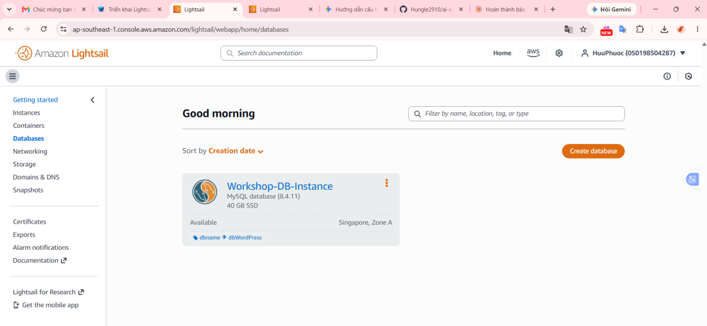
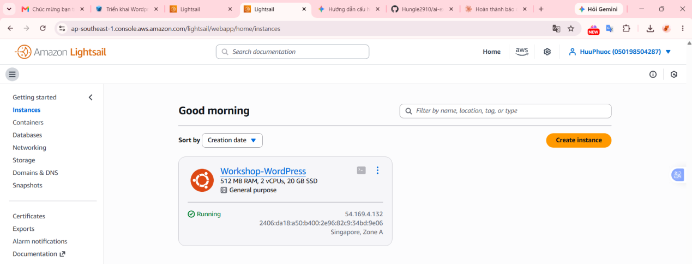
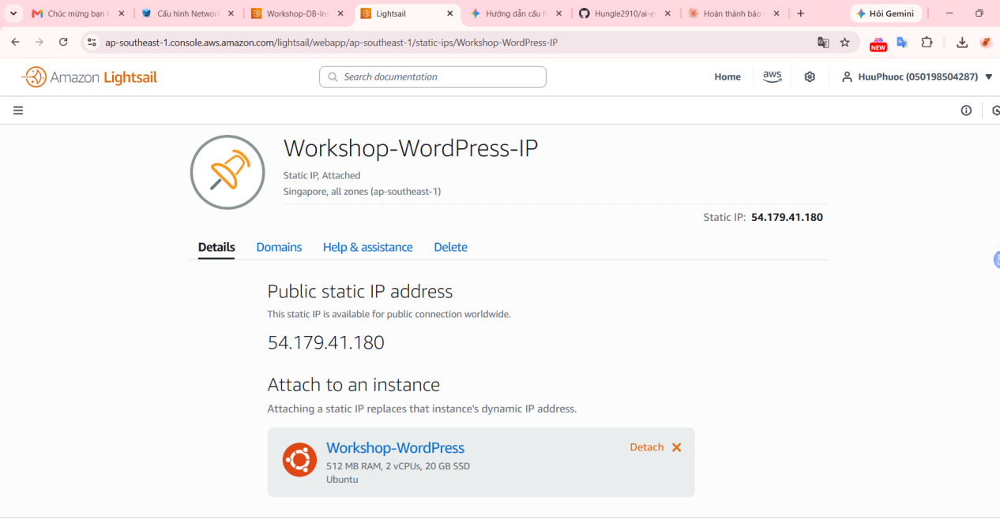
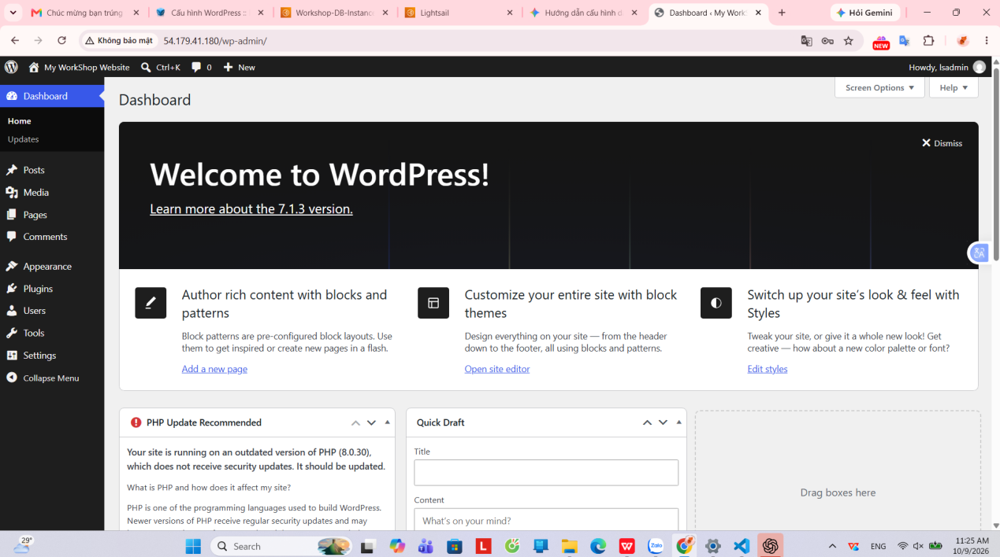

### Week 11 Topic: Amazon Lightsail

Create a Lightsail database and instance, configure Ubuntu and a static IP, and deploy applications.

### Week 11 Objectives:

- Understand the purpose and core concepts of **Amazon Lightsail**.
- Practice the main steps in the AWS Management Console.
- Record configuration, verification results, and lessons learned.

### Tasks to be carried out this week:

| Day | Task | Start Date | Completion Date | Reference Material |
| --- | --- | --- | --- | --- |
| 2 | Read the AWS guide and prepare the knowledge required for Amazon Lightsail. | 23/11/2026 | 23/11/2026 | <https://docs.aws.amazon.com/lightsail/latest/userguide/what-is-amazon-lightsail.html> |
| 3 | Practice creating or configuring resources for Amazon Lightsail. | 24/11/2026 | 24/11/2026 | <https://docs.aws.amazon.com/lightsail/latest/userguide/what-is-amazon-lightsail.html> |
| 4 | Verify status, permissions, connectivity, or deployment results. | 25/11/2026 | 25/11/2026 | <https://docs.aws.amazon.com/lightsail/latest/userguide/what-is-amazon-lightsail.html> |
| 5 | Record configuration details and troubleshoot issues. | 26/11/2026 | 26/11/2026 | <https://docs.aws.amazon.com/lightsail/latest/userguide/what-is-amazon-lightsail.html> |
| 6 | Summarize the results and lessons learned. | 27/11/2026 | 27/11/2026 | <https://docs.aws.amazon.com/lightsail/latest/userguide/what-is-amazon-lightsail.html> |

### Week 11 Achievements:

- Understood the role of **Amazon Lightsail** in AWS.
- Completed the main hands-on steps from the guide.
- Learned how to verify results and record reusable configuration details.

### Week 11 Image Evidence:

Evidence of creating the Lightsail database/instance, configuring Ubuntu and a static IP, and deploying application instances.

