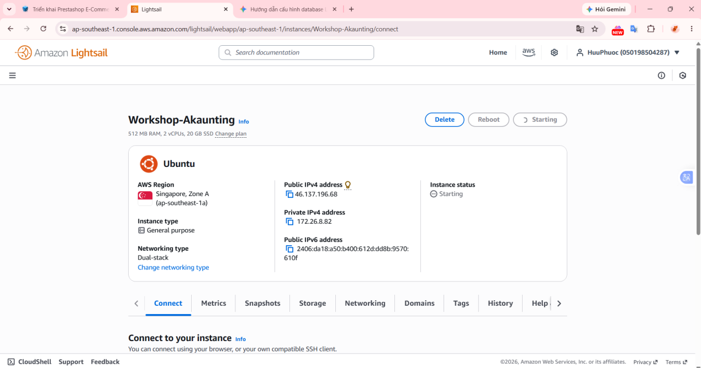

{}
⚠️ **Note:** This page records the hands-on work for the week. AWS links point to official documentation.
{}

### Week 12 Topic: Amazon Lightsail Containers

Package and deploy a container service on Lightsail; verify the application.

### Objectives

- Understand the purpose and core concepts of **Amazon Lightsail Containers**.
- Practice the main steps in the AWS Management Console.
- Record configuration, verification results, and lessons learned.

### Tasks completed

| Day | Task | Result | Reference |
| --- | --- | --- | --- |
| Day 1 | Read the AWS documentation and identify prerequisites and required resources. | Understood the workflow and inputs. | <https://docs.aws.amazon.com/lightsail/latest/userguide/amazon-lightsail-container-services.html> |
| Day 2 | Practice creating/configuring resources for the weekly topic. | Completed the main AWS steps. | <https://docs.aws.amazon.com/lightsail/latest/userguide/amazon-lightsail-container-services.html> |
| Day 3 | Verify status, permissions, connectivity, or deployment results. | Confirmed that the resource worked as expected. | <https://docs.aws.amazon.com/lightsail/latest/userguide/amazon-lightsail-container-services.html> |
| Day 4 | Record configuration details and troubleshoot issues. | Documented the actions and fixes. | <https://docs.aws.amazon.com/lightsail/latest/userguide/amazon-lightsail-container-services.html> |
| Day 5 | Summarize the results and lessons learned. | Completed Week 12 worklog. | <https://docs.aws.amazon.com/lightsail/latest/userguide/amazon-lightsail-container-services.html> |

### Achievements

- Understood the role of **Amazon Lightsail Containers** in AWS.
- Completed the main hands-on steps from the guide.
- Learned how to verify results and record reusable configuration details.

### Image Evidence

Evidence of deploying and verifying the Lightsail container/application.

### References

- AWS guide: <https://docs.aws.amazon.com/lightsail/latest/userguide/amazon-lightsail-container-services.html>
- Sample worklog: <https://thanhzicne.github.io/aws-learning-journey/vi/1-worklog/>
- GitHub: <https://github.com/HuuPhuoc-NH/fcj-workshop-template>

