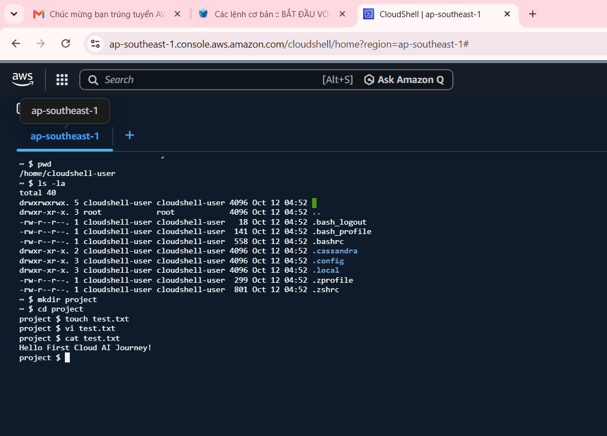
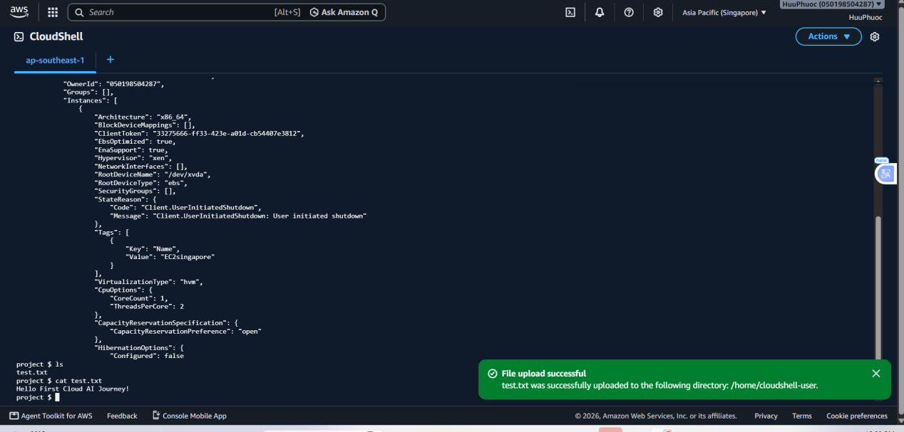
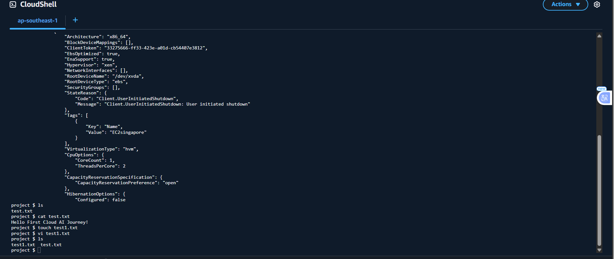
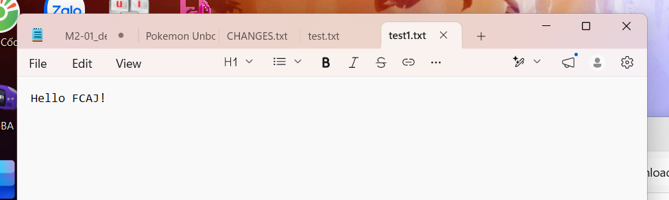

### Week 8 Topic: AWS Cloud9

Create a Cloud9 environment, configure the development environment, and run source code.

### Week 8 Objectives:

- Understand the purpose and core concepts of **AWS Cloud9**.
- Practice the main steps in the AWS Management Console.
- Record configuration, verification results, and lessons learned.

### Tasks to be carried out this week:

| Day | Task | Start Date | Completion Date | Reference Material |
| --- | --- | --- | --- | --- |
| 2 | Read the AWS guide and prepare the knowledge required for AWS Cloud9. | 02/11/2026 | 02/11/2026 | <https://docs.aws.amazon.com/cloud9/latest/user-guide/welcome.html> |
| 3 | Practice creating or configuring resources for AWS Cloud9. | 03/11/2026 | 03/11/2026 | <https://docs.aws.amazon.com/cloud9/latest/user-guide/welcome.html> |
| 4 | Verify status, permissions, connectivity, or deployment results. | 04/11/2026 | 04/11/2026 | <https://docs.aws.amazon.com/cloud9/latest/user-guide/welcome.html> |
| 5 | Record configuration details and troubleshoot issues. | 05/11/2026 | 05/11/2026 | <https://docs.aws.amazon.com/cloud9/latest/user-guide/welcome.html> |
| 6 | Summarize the results and lessons learned. | 06/11/2026 | 06/11/2026 | <https://docs.aws.amazon.com/cloud9/latest/user-guide/welcome.html> |

### Week 8 Achievements:

- Understood the role of **AWS Cloud9** in AWS.
- Completed the main hands-on steps from the guide.
- Learned how to verify results and record reusable configuration details.

### Difficulties encountered

| Problem | Resolution |
| --- | --- |
| I was not familiar with the AWS Cloud9 workflow and console interface. | Re-read the AWS guide, practice step by step, and verify the result after each action. |
| Configuration or permission errors may occur. | Check the Region, policies, and security settings against the official guide. |

### Plan for Week 9

- Continue learning and practicing **Amazon S3** using the AWS guide.
- Record configuration details, verification results, and lessons learned.
- Prepare the resources required for the next week.

### Week 8 Image Evidence:

Evidence of creating and using the Cloud9 development environment.

