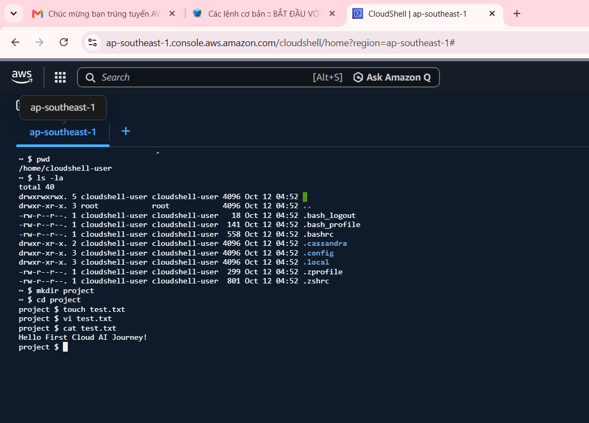
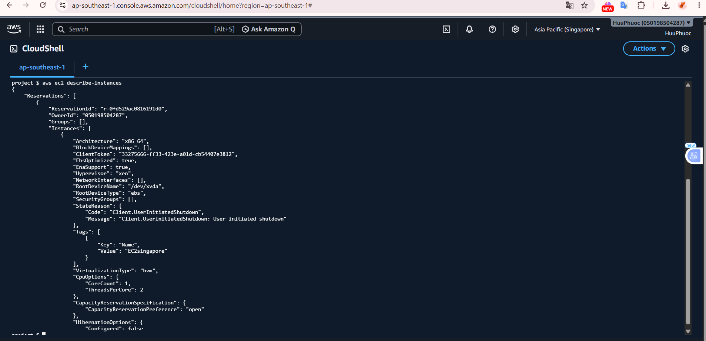
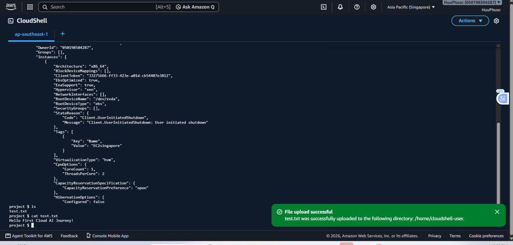
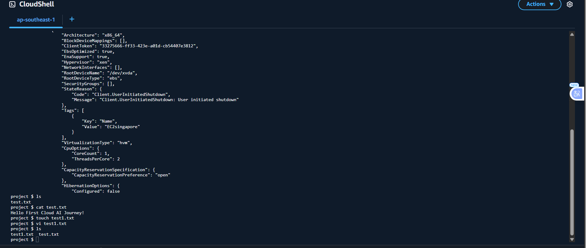
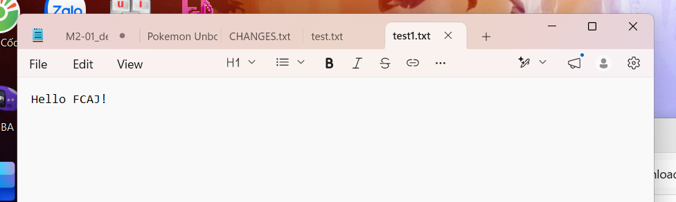

### Chủ đề tuần 8: AWS Cloud9

Tạo môi trường Cloud9, cấu hình môi trường phát triển và chạy thử mã nguồn.

### Mục tiêu

- Hiểu khái niệm và mục đích sử dụng của **AWS Cloud9**.
- Thực hành các bước chính trên AWS Management Console.
- Ghi nhận cấu hình, kết quả kiểm tra và bài học kinh nghiệm.

### Các công việc thực hiện

| Thứ | Công việc | Ngày bắt đầu | Ngày hoàn thành | Nguồn tài liệu |
| --- | --- | --- | --- | --- |
| 1 | Đọc tài liệu AWS và xác định kiến thức, tài nguyên cần chuẩn bị. | Week 8 - Day 1 | Week 8 - Day 1 | <https://docs.aws.amazon.com/cloud9/latest/user-guide/welcome.html> |
| 2 | Thực hành tạo hoặc cấu hình tài nguyên theo chủ đề tuần. | Week 8 - Day 2 | Week 8 - Day 2 | <https://docs.aws.amazon.com/cloud9/latest/user-guide/welcome.html> |
| 3 | Kiểm tra trạng thái, quyền truy cập, kết nối hoặc kết quả triển khai. | Week 8 - Day 3 | Week 8 - Day 3 | <https://docs.aws.amazon.com/cloud9/latest/user-guide/welcome.html> |
| 4 | Ghi chép thông số cấu hình và xử lý lỗi phát sinh. | Week 8 - Day 4 | Week 8 - Day 4 | <https://docs.aws.amazon.com/cloud9/latest/user-guide/welcome.html> |
| 5 | Tổng hợp kết quả và rút kinh nghiệm. | Week 8 - Day 5 | Week 8 - Day 5 | <https://docs.aws.amazon.com/cloud9/latest/user-guide/welcome.html> |

### Kết quả đạt được

- Hiểu vai trò của **AWS Cloud9** trong AWS.
- Thực hiện được các thao tác chính theo hướng dẫn.
- Biết cách kiểm tra kết quả và ghi nhận cấu hình để tái sử dụng.

### Bằng chứng hình ảnh

Bằng chứng tạo và sử dụng môi trường phát triển Cloud9.

### Tài liệu tham khảo

- Hướng dẫn AWS: <https://docs.aws.amazon.com/cloud9/latest/user-guide/welcome.html>
- Worklog mẫu: <https://thanhzicne.github.io/aws-learning-journey/vi/1-worklog/>
- GitHub: <https://github.com/HuuPhuoc-NH/fcj-workshop-template>

