### Week 9 Topic: Amazon S3

Create a bucket, manage objects, configure access, and static website hosting.

### Objectives

- Understand the purpose and core concepts of **Amazon S3**.
- Practice the main steps in the AWS Management Console.
- Record configuration, verification results, and lessons learned.

### Tasks to be carried out this week

| Day | Task | Start Date | Completion Date | Reference Material |
| --- | --- | --- | --- | --- |
| 1 | Read the AWS documentation and identify the knowledge and resources required. | Week 9 - Day 1 | Week 9 - Day 1 | <https://docs.aws.amazon.com/AmazonS3/latest/userguide/WebsiteHosting.html> |
| 2 | Practice creating or configuring resources for the weekly topic. | Week 9 - Day 2 | Week 9 - Day 2 | <https://docs.aws.amazon.com/AmazonS3/latest/userguide/WebsiteHosting.html> |
| 3 | Verify status, permissions, connectivity, or deployment results. | Week 9 - Day 3 | Week 9 - Day 3 | <https://docs.aws.amazon.com/AmazonS3/latest/userguide/WebsiteHosting.html> |
| 4 | Record configuration details and troubleshoot issues. | Week 9 - Day 4 | Week 9 - Day 4 | <https://docs.aws.amazon.com/AmazonS3/latest/userguide/WebsiteHosting.html> |
| 5 | Summarize the results and lessons learned. | Week 9 - Day 5 | Week 9 - Day 5 | <https://docs.aws.amazon.com/AmazonS3/latest/userguide/WebsiteHosting.html> |

### Achievements

- Understood the role of **Amazon S3** in AWS.
- Completed the main hands-on steps from the guide.
- Learned how to verify results and record reusable configuration details.

### Image Evidence

Evidence of creating the bucket, configuring it, and working with the S3 static website.

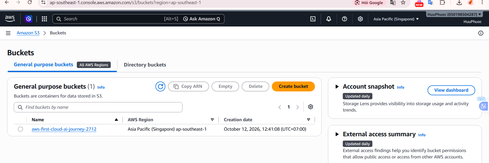

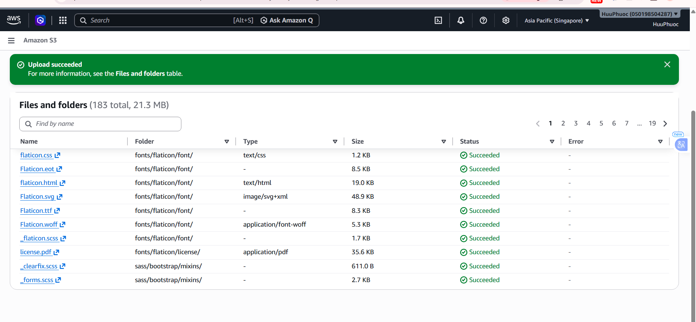

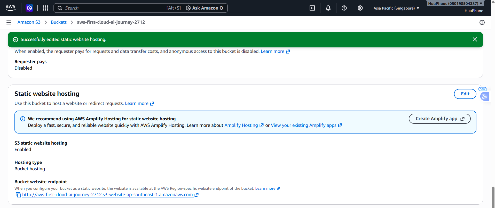

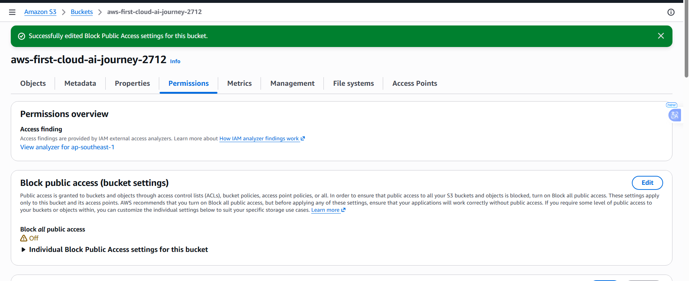

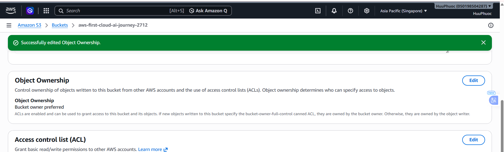

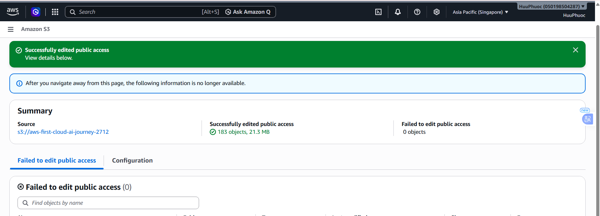

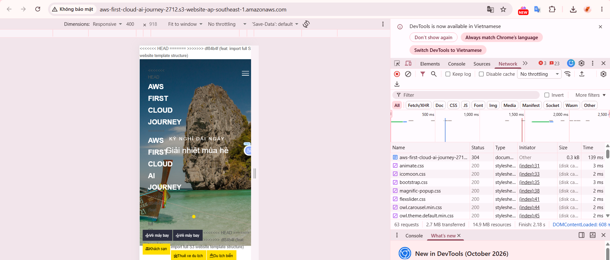

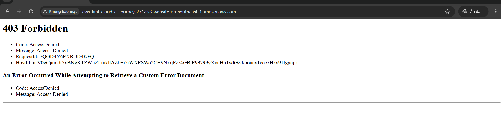

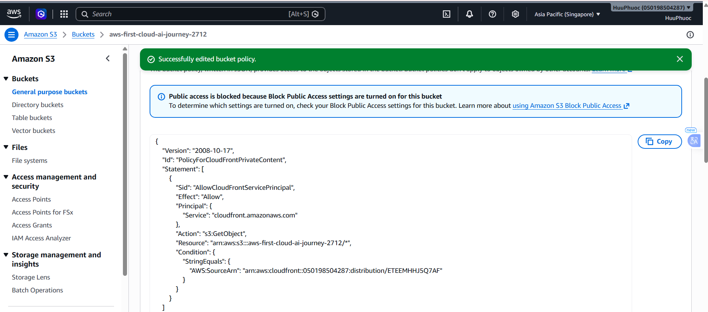

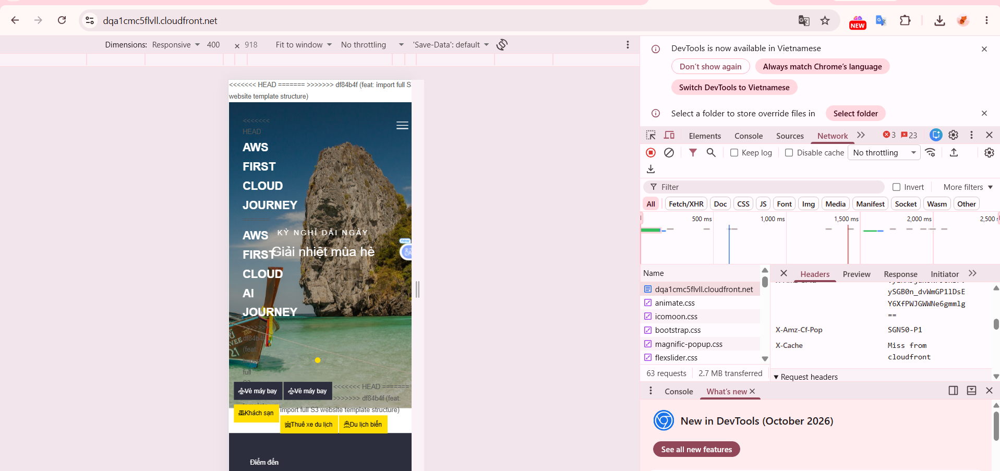

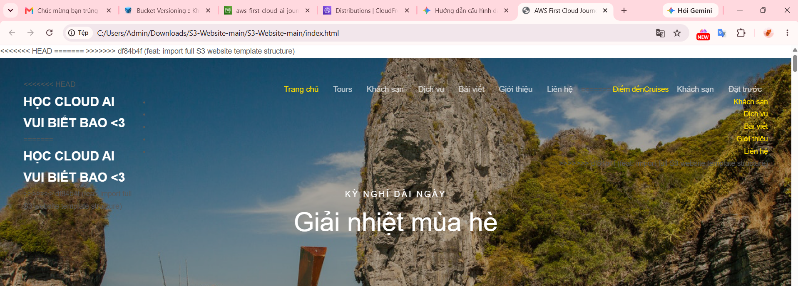

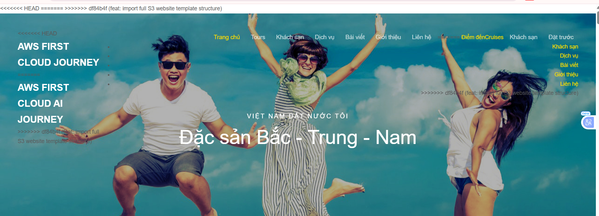

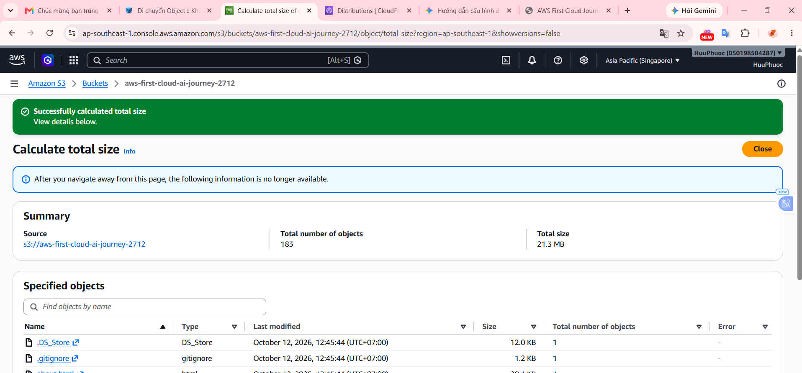

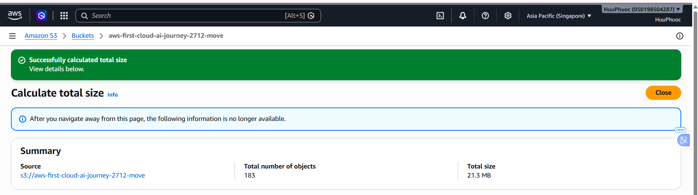

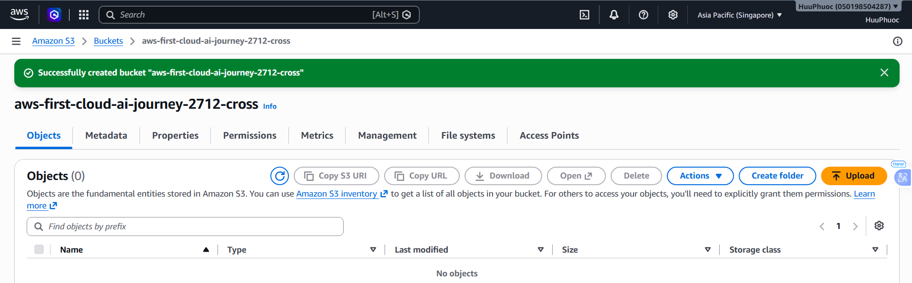

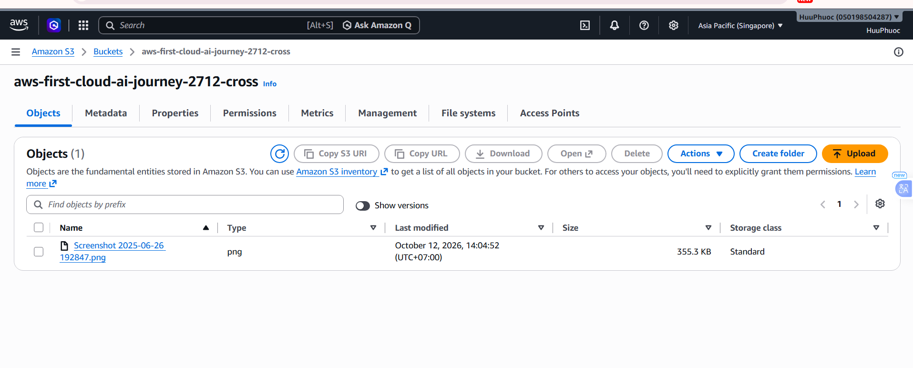

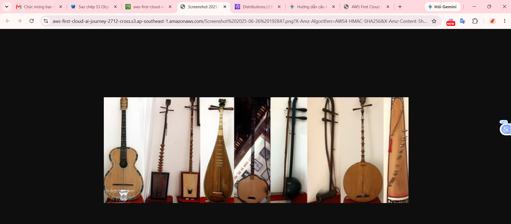

### References

- AWS guide: <https://docs.aws.amazon.com/AmazonS3/latest/userguide/WebsiteHosting.html>
- Sample worklog: <https://thanhzicne.github.io/aws-learning-journey/vi/1-worklog/>
- GitHub: <https://github.com/HuuPhuoc-NH/fcj-workshop-template>

