{}
⚠️ **Lưu ý:** Nội dung được viết lại theo quá trình thực hành; link tham khảo dẫn tới tài liệu chính thức của AWS.
{}

### Chủ đề tuần 9: Amazon S3

Tạo bucket, quản lý object, cấu hình quyền truy cập và static website hosting.

### Mục tiêu

- Hiểu khái niệm và mục đích sử dụng của **Amazon S3**.
- Thực hành các bước chính trên AWS Management Console.
- Ghi nhận cấu hình, kết quả kiểm tra và bài học kinh nghiệm.

### Các công việc thực hiện

| Ngày | Công việc | Kết quả | Nguồn tài liệu |
| --- | --- | --- | --- |
| Ngày 1 | Đọc tài liệu AWS và xác định tài nguyên cần chuẩn bị. | Nắm được quy trình và yêu cầu đầu vào. | <https://docs.aws.amazon.com/AmazonS3/latest/userguide/WebsiteHosting.html> |
| Ngày 2 | Thực hành tạo/cấu hình tài nguyên theo chủ đề tuần. | Hoàn thành các bước chính trên AWS. | <https://docs.aws.amazon.com/AmazonS3/latest/userguide/WebsiteHosting.html> |
| Ngày 3 | Kiểm tra trạng thái, quyền truy cập, kết nối hoặc kết quả triển khai. | Xác nhận tài nguyên hoạt động đúng. | <https://docs.aws.amazon.com/AmazonS3/latest/userguide/WebsiteHosting.html> |
| Ngày 4 | Ghi chép thông số cấu hình và xử lý lỗi phát sinh. | Có nhật ký thao tác và cách khắc phục. | <https://docs.aws.amazon.com/AmazonS3/latest/userguide/WebsiteHosting.html> |
| Ngày 5 | Tổng hợp kết quả và rút kinh nghiệm. | Hoàn thành worklog tuần 9. | <https://docs.aws.amazon.com/AmazonS3/latest/userguide/WebsiteHosting.html> |

### Kết quả đạt được

- Hiểu vai trò của **Amazon S3** trong AWS.
- Thực hiện được các thao tác chính theo hướng dẫn.
- Biết cách kiểm tra kết quả và ghi nhận cấu hình để tái sử dụng.

### Bằng chứng hình ảnh

Bằng chứng tạo bucket, cấu hình và thao tác với static website trên S3.

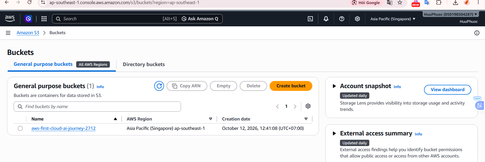

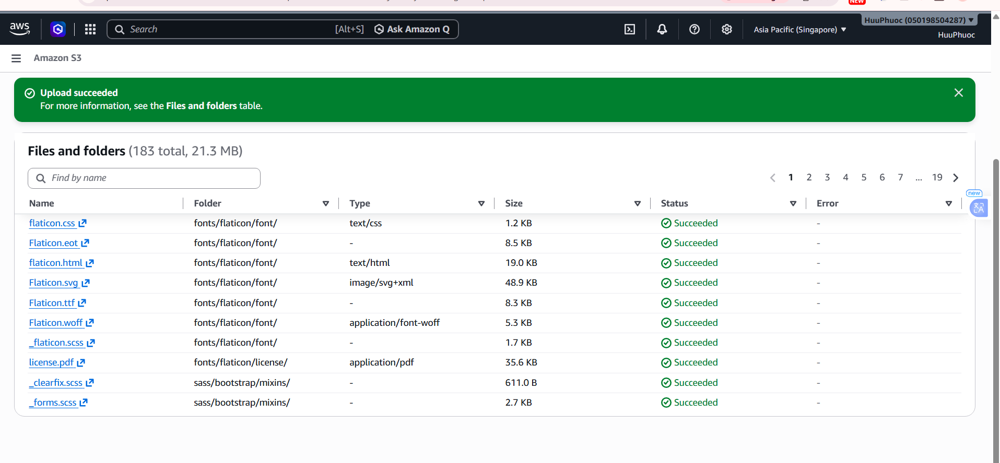

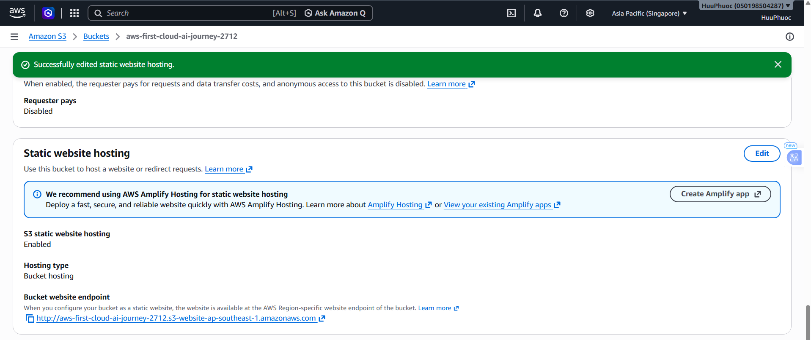

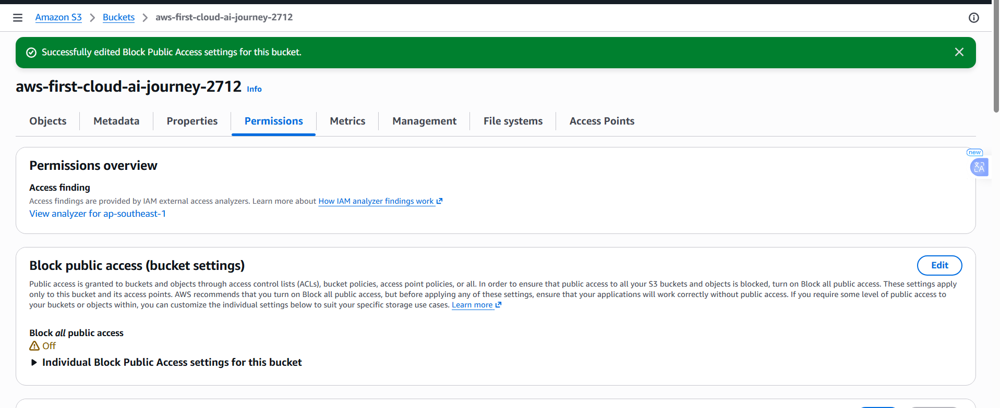

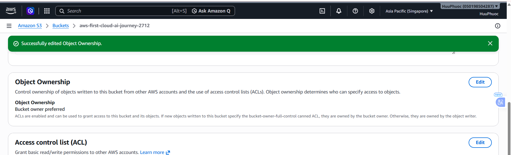

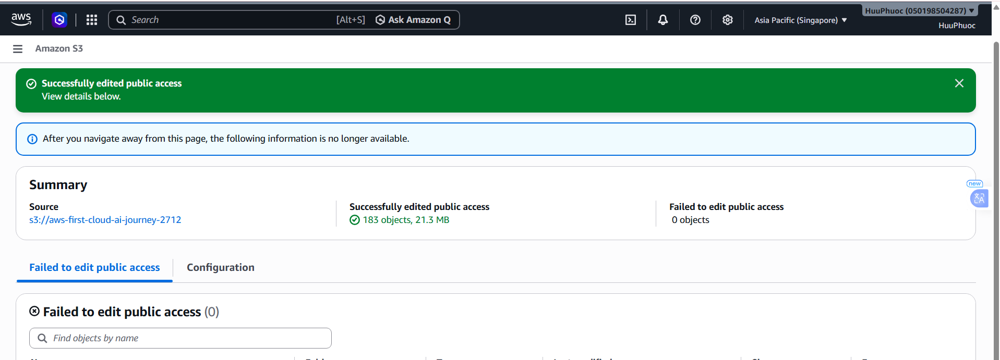

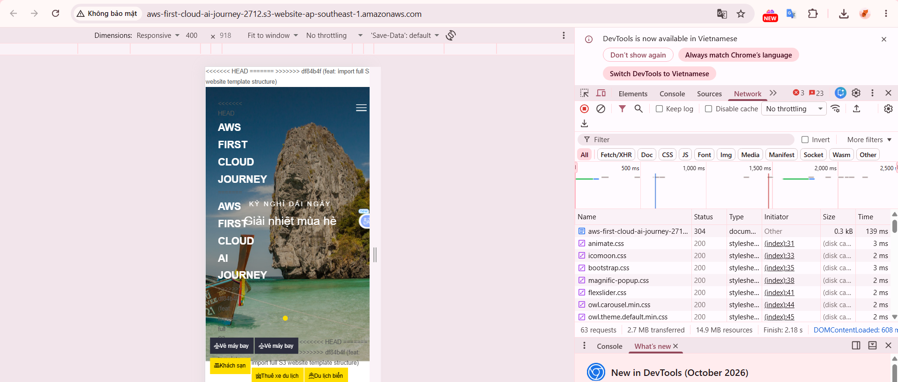

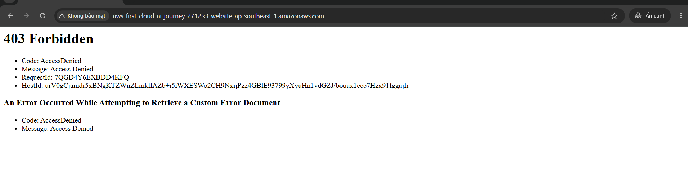

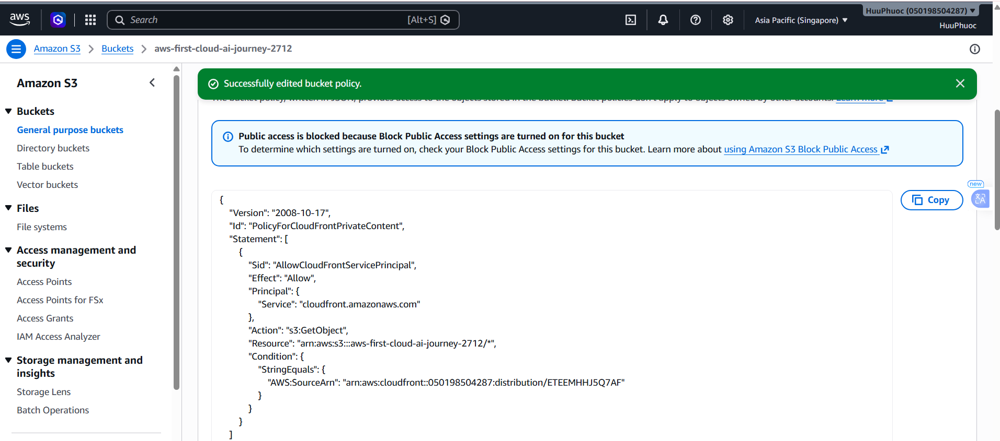

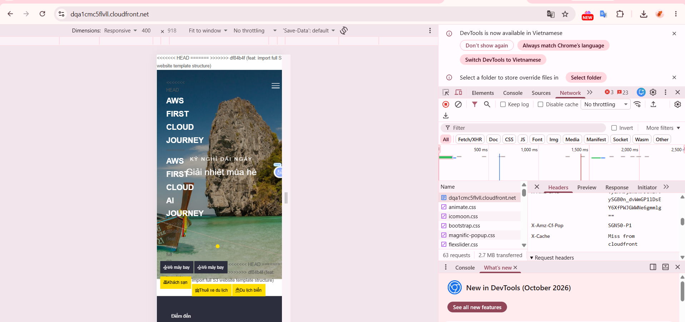

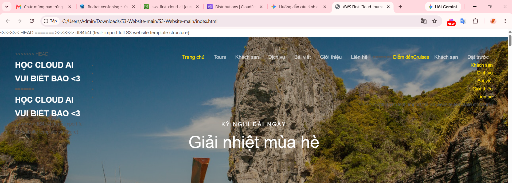

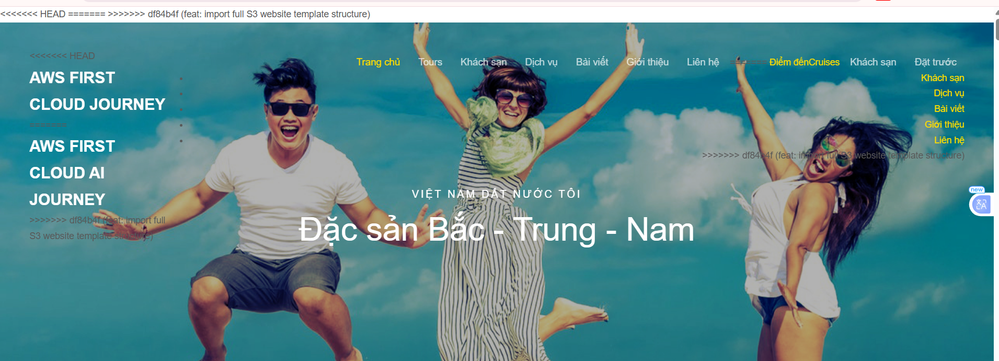

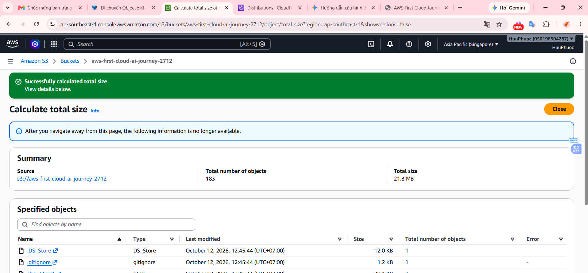

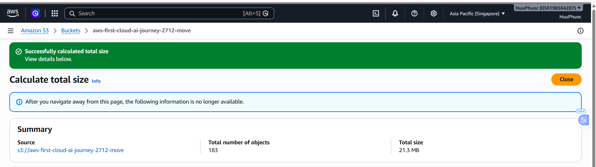

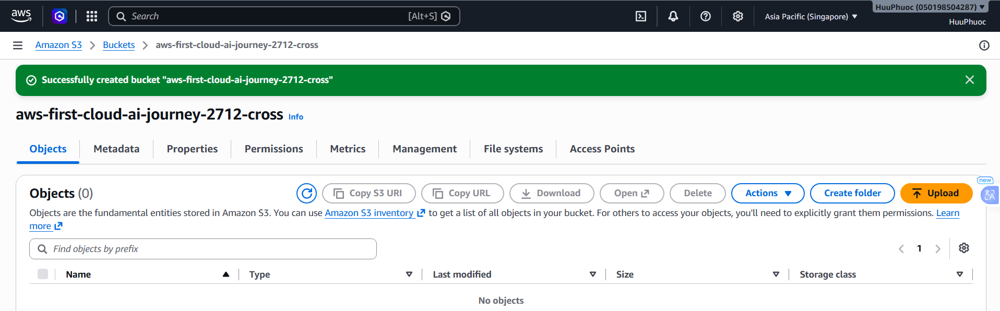

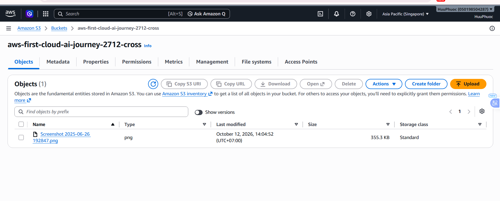

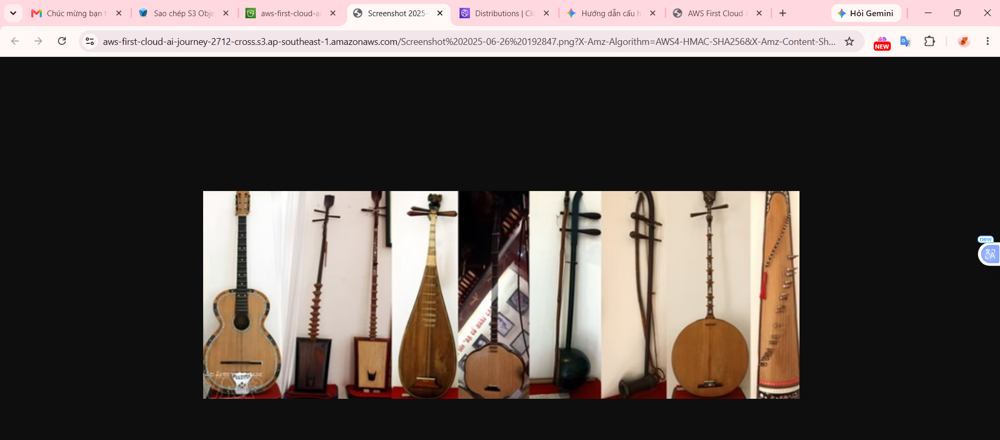

### Tài liệu tham khảo

- Hướng dẫn AWS: <https://docs.aws.amazon.com/AmazonS3/latest/userguide/WebsiteHosting.html>
- Worklog mẫu: <https://thanhzicne.github.io/aws-learning-journey/vi/1-worklog/>
- GitHub: <https://github.com/HuuPhuoc-NH/fcj-workshop-template>

