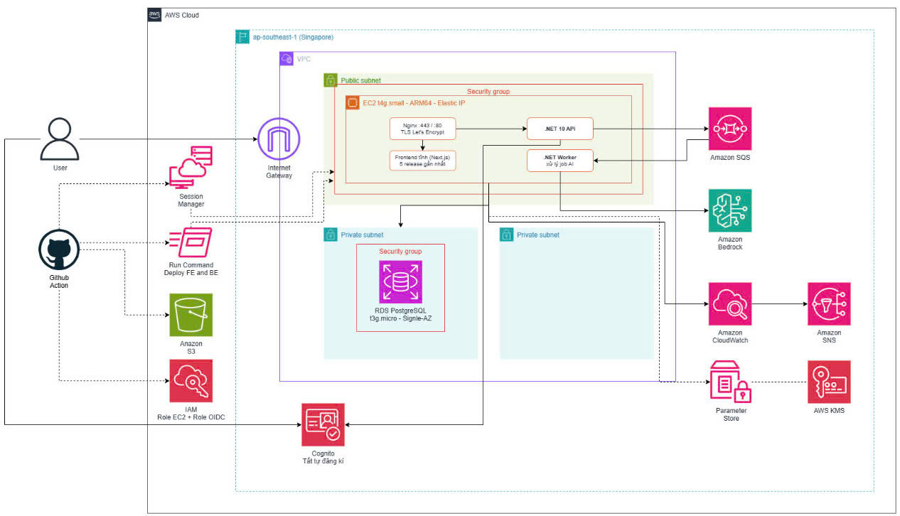

# AI Exam Maker
## A cost-aware AWS platform for AI-assisted exam authoring and approval

### 1. Executive Summary

AI Exam Maker is a web application for Vietnamese high-school teachers. It helps teachers generate draft questions with generative AI, review them, assemble versioned exams, and export a student paper together with a separate answer document. The system is designed as a controlled demonstration environment on AWS, with asynchronous AI processing, department-level approval, auditability, and a target budget of USD 200.

My contribution focuses on the platform foundation and delivery path: deciding the AWS deployment approach, preparing the network and security boundaries, running the application on EC2, configuring the domain and HTTPS, establishing GitHub OIDC, and automating frontend deployment. I also worked with the frontend team to verify the real sign-in flow.

### 2. Project Goals

#### 2.1. General Objective

Build a working AWS-hosted exam platform in which a teacher can sign in, request AI-generated questions, review content, submit it for approval, assemble an exam version, and export the final documents through a controlled workflow.

#### 2.2. Infrastructure Objectives

- Choose a deployment design that fits the two-week delivery window and the USD 200 credit.
- Keep the EC2 application reachable through HTTPS while avoiding inbound SSH.
- Separate public compute from the private database network with security groups that allow only required traffic.
- Use IAM roles, Systems Manager Session Manager, and GitHub OIDC instead of long-lived access keys.
- Provide a repeatable frontend release process with an artifact retained for rollback.
- Verify that Cognito callback and logout URLs work with the real domain.

#### 2.3. Completion Criteria

- The VPC, subnets, routing, security groups, EC2 instance, EBS volume, and Elastic IP support the application without a NAT Gateway.
- Nginx serves the static frontend over HTTPS and forwards API requests to the .NET backend.
- The EC2 instance can be administered through Session Manager without opening port 22.
- GitHub Actions can authenticate through OIDC, upload a release artifact, and trigger deployment through SSM.
- A failed frontend deployment leaves the previous release available for rollback.
- A user can complete the Cognito sign-in flow and return to the application at the configured callback URL.

### 3. Problem Statement

#### 3.1. A single deployment path is not enough

The initial design considered a CDN-based frontend delivery path. When CloudFront was not available for the working environment, the project needed a practical fallback that could still serve the static frontend securely and be operated by a small team.

#### 3.2. Infrastructure must be reproducible

Manually creating resources in the AWS Console makes it difficult to review the configuration and repeat the setup. The project therefore needs an infrastructure folder and a documented runbook, without committing real account IDs, ARNs, secrets, or other environment-specific values.

#### 3.3. Direct server administration increases risk

Opening SSH and storing static credentials would create unnecessary exposure. The platform uses IAM instance profiles and Session Manager for administration, while GitHub Actions uses short-lived OIDC credentials for deployment.

#### 3.4. Frontend releases need a safe recovery path

A deployment can fail while the application is serving users. Each release must be identifiable, checked before activation, and kept alongside the previous release so the server can return to a known working version.

### 4. Solution Architecture

AI Exam Maker runs in the Singapore AWS Region. A public subnet contains the EC2 instance that runs Nginx, the static frontend, the .NET API, and the AI worker. RDS PostgreSQL remains in private subnets. SQS decouples AI jobs, while Cognito, Parameter Store, CloudWatch, SNS, and Budgets support identity, configuration, operations, and cost control.

#### 4.1. Main Components

- **VPC and security groups**: public subnet for EC2, private subnet for RDS, no NAT Gateway, and only required inbound rules.
- **EC2 and EBS**: ARM-based compute with an Elastic IP, Nginx, the .NET API, and the worker managed by systemd.
- **Domain and HTTPS**: the application domain points to the public entry point; Nginx terminates HTTPS and forwards API traffic.
- **Amazon RDS for PostgreSQL**: private database access is limited to the EC2 security group.
- **Amazon Cognito**: sign-in and role groups support the teacher, department head, and administrator flows.
- **Amazon SQS and Amazon Bedrock**: the API queues generation jobs and the worker processes them asynchronously.
- **Amazon S3 and AWS Systems Manager**: S3 stores release packages; SSM Run Command starts deployment on EC2.
- **GitHub Actions and IAM OIDC**: the workflow obtains temporary AWS credentials without a stored access key.
- **CloudWatch, SNS, and AWS Budgets**: logs, alarms, notifications, and spending limits support the demonstration environment.

#### 4.2. Frontend Delivery Flow

GitHub Actions builds and checks the static Next.js export. The workflow packages a release with a checksum and uploads it to an S3 prefix for the project. It then calls SSM. The EC2 deployment script downloads the artifact, verifies it, extracts a new release directory, updates the `current` symlink, reloads Nginx, and keeps the previous release available for rollback. When CloudFront can be used, the design can return to CDN delivery; the S3–SSM–EC2 path is the working fallback.

#### 4.3. Security Principles

- No inbound SSH is required; administration uses Session Manager.
- EC2 and RDS communicate through security-group references rather than broad network access.
- GitHub receives temporary role credentials through OIDC.
- Secrets and environment-specific identifiers stay outside the repository.
- Backend authorization remains the source of truth for roles, departments, ownership, and content state.

### 5. Project Timeline

The implementation follows the team roadmap from 17 November to 1 December 2026.

- **Foundation**: confirm the AWS decisions, document the infrastructure approach, and prepare the repository boundaries.
- **Platform setup**: create the VPC, security groups, EC2, EBS, Elastic IP, Session Manager access, domain, and HTTPS.
- **Delivery automation**: configure OIDC, the deployment role, the S3 release path, SSM Run Command, and frontend rollback behavior.
- **Integration and verification**: test Cognito sign-in with the frontend team, check health and deployment behavior, and prepare evidence for the demo.

### 6. Budget Estimation

The architecture is intentionally compact so the project remains within the USD 200 development credit. The main cost drivers are EC2 hours, EBS storage, the public IPv4 address, RDS hours and storage, AI model usage, logs, and data transfer. S3, SQS, Cognito, Parameter Store, SNS, and Systems Manager are kept within the expected low-volume demonstration usage where possible.

Cost-control measures include stopping EC2 and RDS outside working hours, using a cheaper model during development, limiting AI requests and tokens, retaining only the required logs and release artifacts, and configuring AWS Budgets alerts at 50%, 80%, and 100%.

### 7. Risk Assessment & Mitigation

| Risk | Impact | Mitigation |
|---|---|---|
| CloudFront is unavailable for the environment | Medium | Serve the static frontend through Nginx on EC2 and use S3 plus SSM for releases. |
| A deployment fails after the artifact is uploaded | High | Verify the checksum and health result; keep the previous release and provide rollback. |
| EC2 or RDS becomes unavailable | High | Use systemd restart behavior, RDS backups, a tested restore procedure, and documented trade-offs for the demo environment. |
| A security group is too permissive | High | Close SSH, restrict RDS to the EC2 security group, and review the required ports and prefix lists. |
| Long-lived AWS credentials leak | High | Use IAM instance profiles and GitHub OIDC with least-privilege policies. |
| AI cost grows beyond the credit | High | Enforce quotas and token ceilings, use budget alerts, and stop nonessential resources outside working hours. |
| Cognito callback configuration is incorrect | Medium | Test sign-in, callback, logout, and protected API access end to end with the real domain. |

### 8. Conclusion & Expected Outcomes

The proposed platform combines AI-assisted question generation with an accountable review and exam-publication workflow. My infrastructure work gives the team a secure and repeatable path from a GitHub commit to a running frontend, while preserving a fallback when CloudFront cannot be used. The expected result is a demo-ready AWS environment with clear network boundaries, HTTPS, Session Manager administration, OIDC-based deployment, observable services, and documented rollback and cost controls.

The same structure can later be extended with a load balancer, Multi-AZ database, CDN, richer document import, and higher availability when the project moves beyond the demonstration stage.
