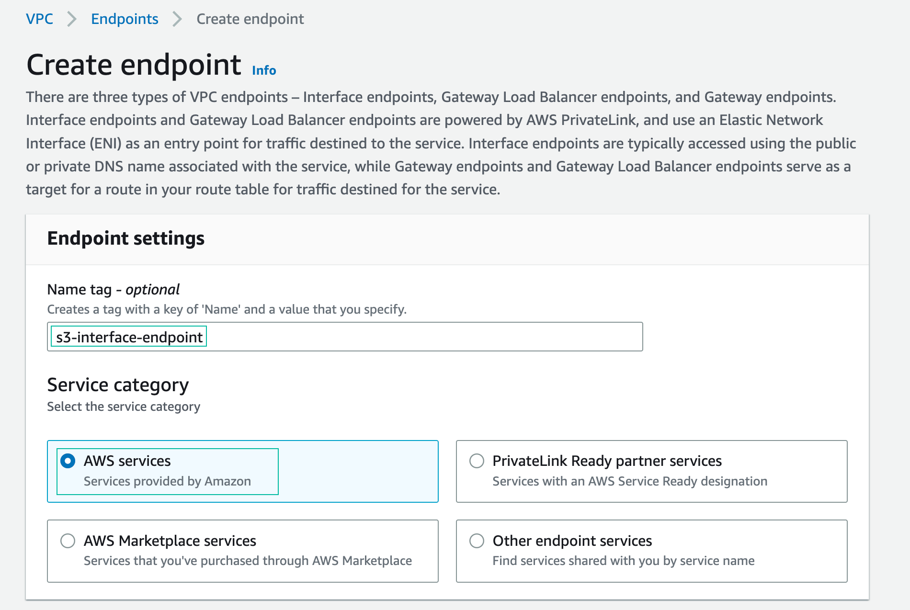
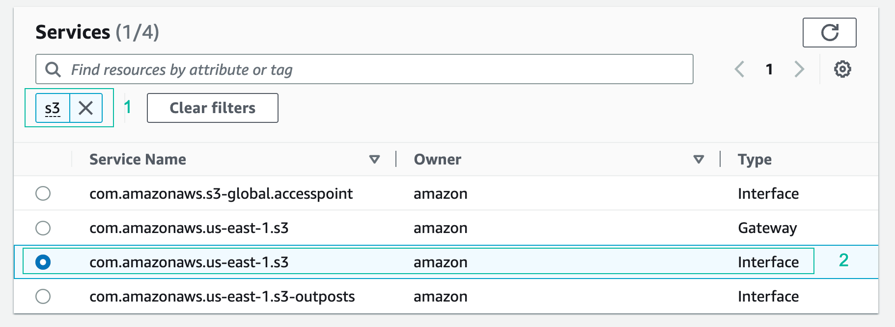
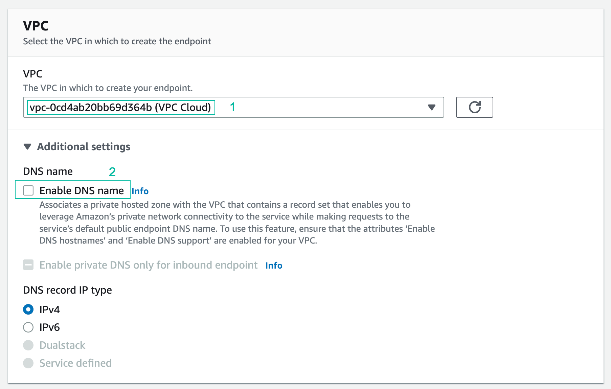
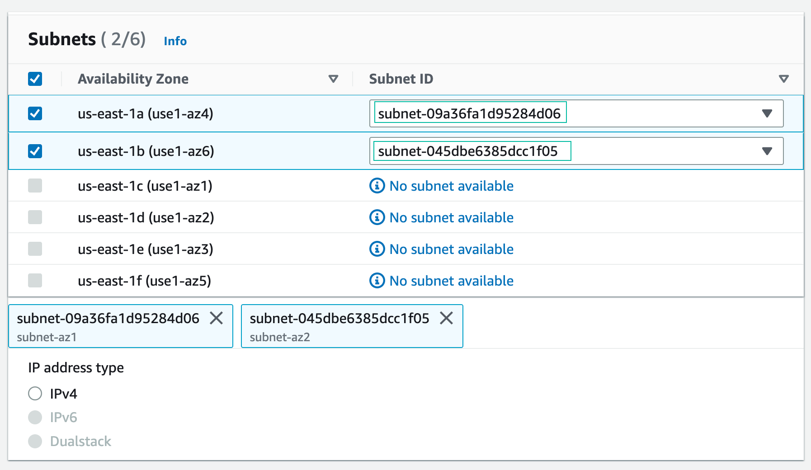
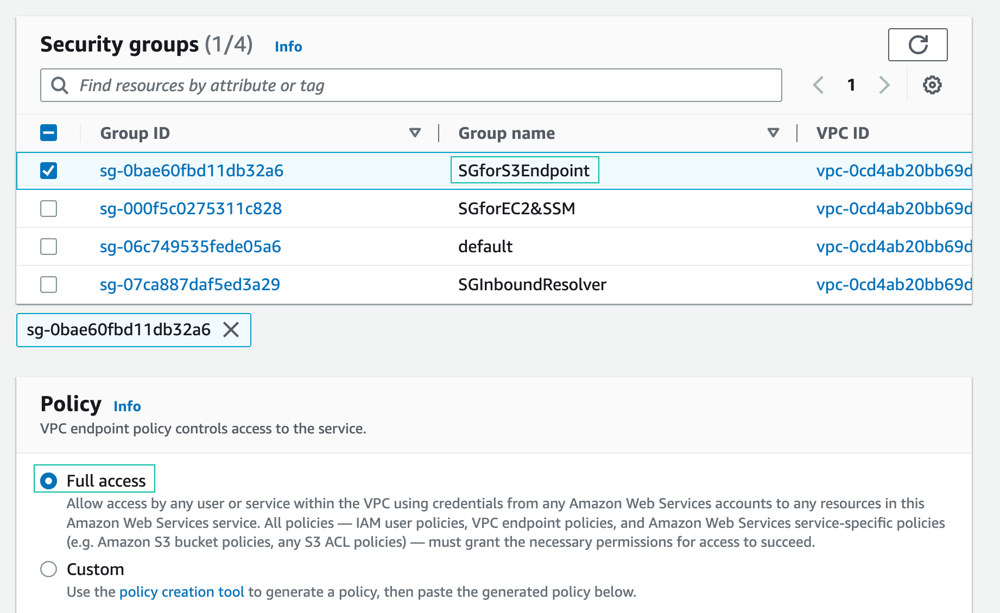
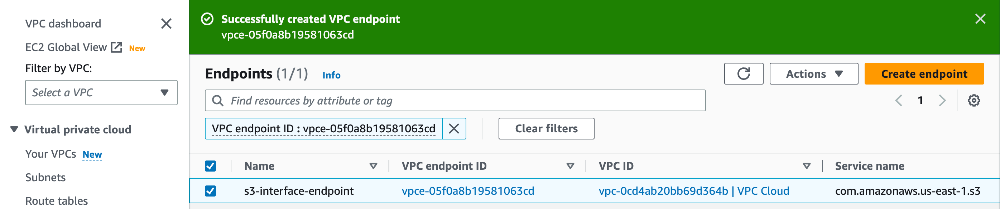

---\ntitle : "Create an S3 Interface endpoint"\ndate : 2024-01-01\nweight : 2\nchapter : false\npre : " <b> 5.4.2 </b> "\n---\n\nIn this section you will create and test an S3 interface endpoint using the simulated on-premises environment deployed as part of this workshop.\n\n1. Return to the Amazon VPC menu. In the navigation pane, choose Endpoints, then click Create Endpoint.\n\n2. In Create endpoint console:\n+ Name the interface endpoint\n+ In Service category, choose **aws services**\n\n\n\n3.  In the Search box, type S3 and press Enter. Select the endpoint named com.amazonaws.us-east-1.s3. Ensure that the Type column indicates Interface.\n\n\n\n4. For VPC, select VPC Cloud from the drop-down.\n+ Expand **Additional settings** and ensure that Enable DNS name is *not* selected (we will use this in the next part of the workshop)\n\n\n\n5. Select 2 subnets in the following AZs: us-east-1a and us-east-1b\n\n\n\n6. For Security group, choose SGforS3Endpoint:\n\n\n\n7. Keep the default policy - full access and click Create endpoint\n\n\n\nCongratulation on successfully creating S3 interface endpoint. In the next step, we will test the interface endpoint.\n