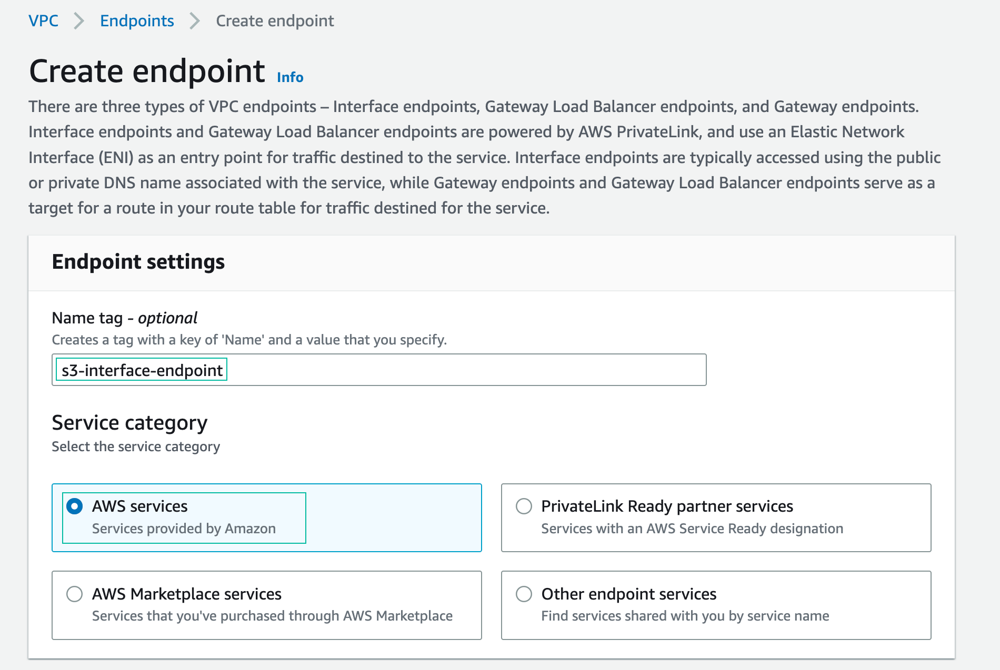
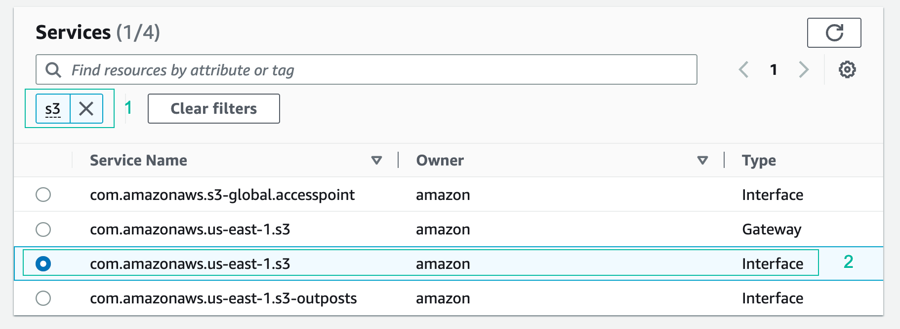
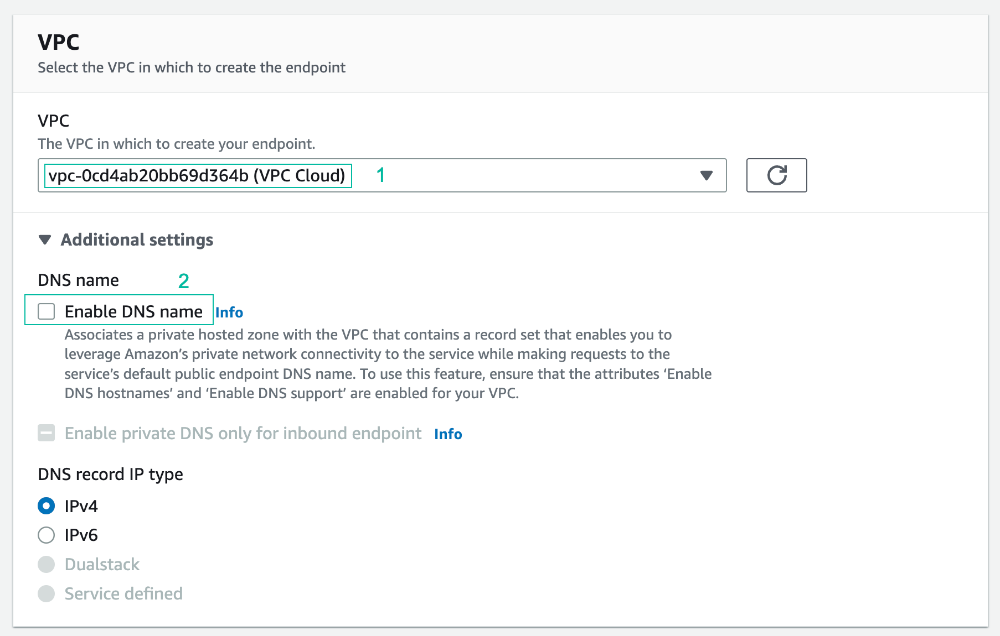
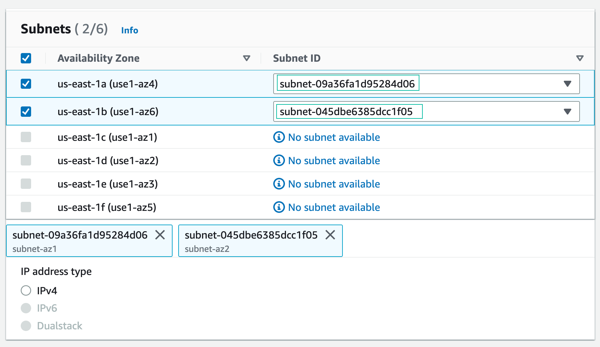
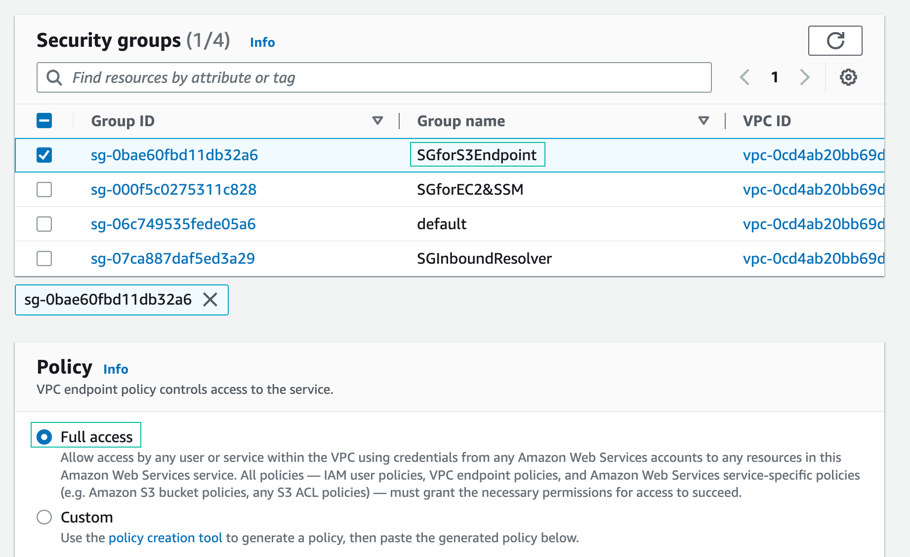
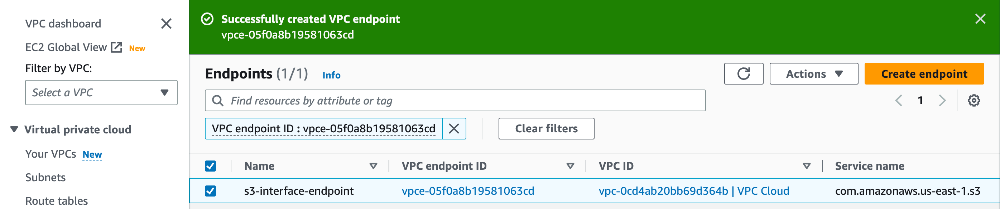

---\ntitle : "Tạo một S3 Interface endpoint"\ndate : 2024-01-01\nweight : 2\nchapter : false\npre : " <b> 5.4.2 </b> "\n---\n\nTrong phần này, bạn sẽ tạo và kiểm tra Interface Endpoint  S3 bằng cách sử dụng môi trường truyền thống mô phỏng.\n\n1. Quay lại Amazon VPC menu. Trong thanh điều hướng bên trái, chọn Endpoints, sau đó click Create Endpoint.\n\n2. Trong Create endpoint console:\n+ Đặt tên interface endpoint\n+ Trong Service category, chọn **aws services**\n\n\n\n3.  Trong Search box, gõ S3 và nhấn Enter. Chọn endpoint có tên com.amazonaws.us-east-1.s3. Đảm bảo rằng cột Type có giá trị Interface.\n\n\n\n4. Đối với VPC, chọn VPC Cloud từ drop-down.\n+ Mở rộng **Additional settings** và đảm bảo rằng Enable DNS name *không* được chọn (sẽ sử dụng điều này trong phần tiếp theo của workshop)\n\n\n\n5. Chọn 2 subnets trong AZs sau: us-east-1a and us-east-1b\n\n\n\n6. Đối với Security group, chọn SGforS3Endpoint:\n\n\n\n7. Giữ default policy - full access và click Create endpoint\n\n\n\nChúc mừng bạn đã tạo thành công S3 interface endpoint. Ở bước tiếp theo, chúng ta sẽ kiểm tra interface endpoint.\n